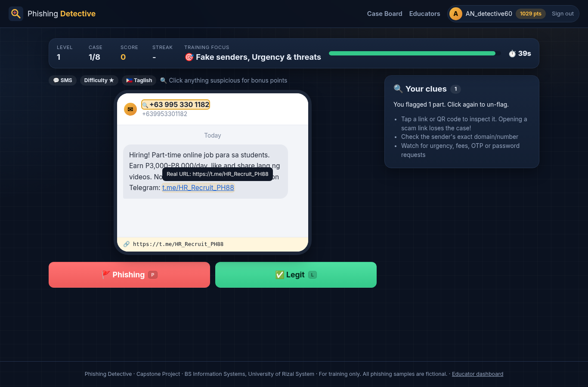

# 🕵️ Phishing Detective
### Interactive Web Game for Cybersecurity Awareness

A browser-based game where university students identify phishing emails, SMS, social-media DMs, QR codes and scam phone calls (in English, Filipino and Taglish) through timed challenges. Players learn real-world detection skills with instant feedback, an adaptive AI coach, badges and daily challenges; educators run class sections, see per-student weakness reports and export a ready-made Chapter 4 statistics PDF.

> Capstone Project · BS Information Systems · University of Rizal System (Philippines)

| | |
|---|---|
| **Problem** | Students lack practical experience recognizing phishing attempts, leading to high susceptibility to security breaches. |
| **Target users** | University students (Filipino context: GCash, BDO/BPI, scholarships, enrollment/portal, Shopee/Lazada, LBC, job offers) |
| **Stack** | React 18 + Vite (HTML5/JS) · Node.js + Express · Supabase Postgres in production, SQLite for zero-setup local dev |
| **Live demo** | https://phishing-detective-mu.vercel.app (Vercel + Supabase) |
| **Expected impact** | ≥ 20% improvement in detection rate, measured by pre- vs post-game quizzes (computed live on the admin dashboard) |



---

## 1. Quick start

Requirements: **Node.js 18+** (tested on Node 24) and npm.

```bash
npm install          # installs root, client and server (npm workspaces)
cp server/.env.example server/.env   # optional; defaults work without it

# Development (hot reload): API on :3000 + Vite on :5173 (proxying /api)
npm run dev          # open http://localhost:5173

# Production: build the React app and serve it from Express
npm run build
npm start            # open http://localhost:3000
```

The SQLite database (`server/data/phishing-detective.db`) is created and seeded with **60 scenarios** automatically on first start. No database setup is needed.

### Admin accounts (no default password)
There is **no built-in admin password**. On first start, if the `admins` table is empty, the server creates one **superadmin** from `SUPERADMIN_USERNAME` (default `superadmin`) and `SUPERADMIN_PASSWORD` in `server/.env`. Without `SUPERADMIN_PASSWORD` the dashboard stays disabled. Use a long random password (≥ 10 characters with letters and numbers), and set a random `APP_SECRET` for signing tokens. The superadmin then creates **educator** accounts in **/admin → Study & accounts**. Educators open **/admin** (or the footer link "Educator dashboard").

### Useful scripts
| Command | What it does |
|---|---|
| `npm run dev` | Runs the server (`node --watch`) and the Vite client together |
| `npm run build` | Builds the React client to `client/dist` |
| `npm start` | Starts Express on `PORT` (default 3000) and serves `client/dist` |
| `npm test` | API integration tests (`node:test`, in-memory SQLite) |
| `npm run test:pg` | Same tests against Postgres (PGlite) after applying `supabase/migrations/*` |
| `npm run test:api` | End-to-end smoke test against a running server; creates and then deletes one `smoke_*` player (`ADMIN_USER=… ADMIN_PASS_FILE=… npm run test:api -- <url>`) |
| `npm run demo` | Simulates 12 `demo_student##` players through the real API so the dashboard has sample data (`DEMO_SECTION_CODES=AAA111,BBB222` spreads them across class sections) |
| `npm run seed` | **Resets the local SQLite** database (deletes all players/results) and re-seeds the scenario bank. Never touches Postgres |
| `python3 scripts/screenshots.py` | Headless Playwright walkthrough + screenshots into `screenshots/` (`ADMIN_PASS_FILE`, optional `EDU_USER`, `EDU_PASS_FILE`, `SECTION_CODE`) |

> ⚠️ Before collecting real study data, run `npm run seed` to wipe test and demo players.

---

## 1b. Deploying to Vercel + Supabase

Production runs on **Vercel**: the static Vite build is served from the CDN and Express runs as one serverless function. Data lives in **Supabase Postgres**, because SQLite files don't persist on serverless.

- `api/index.js` is the serverless entry. It wraps the same Express app (`createApp()` in `server/src/index.js`).
- `vercel.json` builds with `npm run build`, serves `client/dist`, rewrites `/api/*` to the function and everything else to `index.html` (SPA fallback). The function region is `sin1` (Singapore, next to the Supabase project).
- Storage is picked automatically: `DATABASE_URL` set → Postgres (`server/src/db/drivers/postgres.js`), otherwise SQLite. Both share one repository (`server/src/db/repo.js`). Schema changes are **additive migrations** in `supabase/migrations/`, mirrored for SQLite in `server/src/db/migrate-sqlite.js`. See [`docs/supabase-migration.md`](docs/supabase-migration.md).

Vercel environment variables (Project → Settings → Environment Variables):

| Name | Value |
|---|---|
| `DATABASE_URL` | Supabase **pooler** URL (port 6543) for the `pd_app` role |
| `SUPERADMIN_USERNAME` | first superadmin's username (used only while no admin exists) |
| `SUPERADMIN_PASSWORD` | first superadmin's password (sensitive; generated randomly, never committed) |
| `ADMIN_SECRET` or `APP_SECRET` | long random string used to sign player and admin tokens |
| `AI_GATEWAY_API_KEY` | *optional.* Vercel AI Gateway key for the scenario generator and AI coach. On Vercel, OIDC is used automatically when the key is absent |
| `AI_GATEWAY_MODEL` | *optional.* Gateway model id, default `openai/gpt-5.4-mini` |
| `AI_ENABLED` | *optional.* `false` turns every AI feature off (players get static coach tips) |
| `PUBLIC_URL` | *optional.* Base URL printed on certificates (defaults to the request host) |

**AI requirements.** AI features run through the [Vercel AI Gateway](https://vercel.com/docs/ai-gateway). The gateway refuses requests until the Vercel team has a **credit card on file** (this unlocks the free monthly credits), or you provide an `AI_GATEWAY_API_KEY` from a team that has one. Without that, everything else works: the generator shows the reason, and the coach serves static tips.

Deploy from the CLI:
```bash
npm i -g vercel
vercel link            # pick/create the project
vercel deploy --prod
```
Or import the GitHub repo in the Vercel dashboard. The settings in `vercel.json` are picked up automatically.

---

## 2. How the game works

1. **Consent and register**: read the RA 10173 (Data Privacy Act) notice and tick consent (timestamp + version stored), then choose a nickname or student ID (3-24 letters/numbers, `_ . -`) and a **4-6 digit PIN** (bcrypt-hashed). Sign in again from any device with ID + PIN.
   - Each new player is **randomly assigned** to the **experimental** (game) or **control** group (ratio configurable; admins can override).
   - Students can enter their teacher's **class join code** on the case board to join a section.
2. **Pre-game quiz**: 10 messages, Phishing or Legit plus a **confidence rating (1-5)** for each, no timer and no feedback (so it doesn't teach the answers).
   - **Control group** (wait-list design): a neutral reading task instead of the game, then the post-quiz, then the retention check. The game opens for them after that.
3. **Game modes**
   - **Classic**: 8 randomized messages per round (40s / 35s / 30s per message for difficulty 1 / 2 / 3, +10s for calls). Click anything suspicious to mark it as a **clue**; hover/tap links to see the **real URL**; decide **🚩 Phishing** or **✅ Legit** (`P` / `L`, `Enter` for next).
   - **Inbox**: sort 6/8/10 messages against one shared clock, like a real inbox.
   - **Daily challenge**: 5 cases chosen for the calendar day (Asia/Manila), the same for everyone, one attempt, with a daily streak and a daily leaderboard.
   - **Message types**: email, SMS, social DMs, **QR codes** (scan to read the decoded URL) and **vishing call transcripts** (with text-to-speech "Listen"); filter by English or Filipino/Taglish.
   - **Link trap**: opening a phishing link (or scanned QR) loses the case and shows a "You got phished" page with what to do in real life. Legit links only show a safe note.
4. **Instant feedback**: verdict, points breakdown, every red flag highlighted (green = caught, red = missed), safe signs for legit messages, an explanation, and the **AI coach**: a 2-3 sentence tip tailored to the player's weakest red-flag categories (static category tip if AI is unavailable).
5. **Adaptive rounds**: every answer updates the player's per-category weakness (fake senders, links & QR, urgency, OTP/PIN requests, fees & prizes, attachments, manipulation, recognising legit messages). After enough evidence, new rounds lean towards the weakest categories; the HUD shows the current training focus and the case board shows "Your weak spots".
6. **Progressive difficulty**: Level 2 unlocks at ≥ 70% accuracy in a Level 1 round; Level 3 at ≥ 70% in Level 2.
7. **Post-game quiz**: unlocked after `minRoundsForPost` finished rounds (default 1). 10 *different* messages with confidence ratings, then a full answer review.
8. **Delayed retention check**: a third pool of 10 items unlocks `retentionDays` (default 14) after the first post-quiz.
9. **Surveys**: after the post-quiz, the standard **SUS** (10 items) and an **ISO/IEC 25010** Likert form (16 items, 8 characteristics).
10. **Certificate**: after the post-quiz, a printable PDF certificate with pre/post/retention scores, rounds, accuracy, badges, a verification code and a QR code. Anyone can check it at **`/verify/<code>`**.

### Scoring
| Component | Rule |
|---|---|
| Base | 100 × difficulty (correct answers only) |
| Time bonus | up to +50, proportional to time left |
| Streak multiplier | ×1.0, ×1.1, … up to ×1.5 for consecutive correct answers |
| Clue bonus | +20 per correctly clicked red flag, −10 per wrong click |
| Timeout / opened scam link | counts as incorrect, 0 points, resets streak |

Ranks: Rookie → Detective (1,000) → Senior Inspector (3,000) → Chief Detective (6,000).

### Gamification
- **12 badges**: Rookie Detective, Flawless, Hot Streak, Eagle Eye, Call Screener, QR Wise, Lokal Detective, Hands Off, Master Detective, Daily Habit, Level Up, Research Partner (progress shown for locked ones; awarded server-side from the player's own records).
- **Leaderboards**: top detectives, today's daily challenge, and **class vs class** (ranked by average points per active player, so small sections can win).

### Educator tools
- **Class sections** with 6-character join codes. **Educators see only students in their own sections; superadmins see everyone** and can filter by section. This applies to every stat, list, CSV export, report and PDF.
- **Per-student weakness report**: pre/post/retention and gain, rounds, accuracy, confidently-wrong answers, scam links opened, all eight red-flag categories, focus areas with what to teach, recently missed cases (printable).
- **Class report**: class weak spots plus one row per student with their weakest area.
- **Chapter 4 PDF** (`📄 Chapter 4 PDF`, per scope or per class): participant profile, descriptive statistics for pre/post/retention by group, paired-samples t-test and Wilcoxon signed-rank (post vs pre, retention vs post), Welch t and Mann-Whitney U between groups, in-game accuracy by level/channel, red-flag weakness ranking, confidence calibration, SUS and ISO 25010 tables, with auto-written interpretations. All statistics are computed server-side.
- **AI scenario generator** (admin → 🤖 AI drafts): choose channel, verdict, difficulty, language and topic; drafts are validated and saved as **pending**. Nothing reaches players until an educator approves it (approve re-validates; reject keeps it out).

---

## 3. Mapping to the capstone objectives

| Objective / feature in the proposal | Where it is implemented |
|---|---|
| Browser-based game, HTML5 + JavaScript (React) | `client/` (React 18 + Vite SPA, mobile-friendly CSS) |
| Node.js backend serving randomized scenarios | `server/src/routes/game.js`, `lib/game.js` → `pickScenarios()` / `pickWithLanguage()` (level-weighted, phishing/legit mix, language filter) |
| **Randomized phishing scenarios** | 60 seed scenarios (`server/src/data/scenarios.js` + `scenarios-ph2.js`): 35 phishing / 25 legit across email, SMS, social DMs, 3 QR codes and 4 vishing calls; 22 in Filipino or Taglish; each with red flags + explanation. Admins add more by hand or with the reviewed AI generator |
| Timed challenges | Per-message countdown (`pages/Game.jsx`, `components/Timer.jsx`), shared inbox clock (`pages/Inbox.jsx`), daily challenge (`lib/daily.js`) |
| **Score and feedback system** | Server-side `scoreAnswer()`; feedback panel with highlighted red flags; AI coach with static fallback (`lib/ai.js` → `coachText()`) |
| **Progressive difficulty levels** | `unlockedLevels()` in `lib/game.js` (70% rule); adaptive weighting towards weak categories (`lib/adaptive.js`, `lib/categories.js`) |
| **Admin dashboard for educators** | `pages/Admin.jsx` + `routes/admin.js`: scoped overview, group comparison with significance tests, miss rates, players, sessions, class sections, student/class weakness reports, Chapter 4 PDF, CSV exports, scenario CRUD, AI draft review, accounts and study settings |
| Gamification | Points, streaks, ranks, level unlocks, 12 badges (`lib/badges.js`), daily challenge + streak, class-vs-class leaderboard, certificate with `/verify` (`lib/certificate.js`, `pages/Verify.jsx`) |
| Analytics | Every answer is logged (choice, correctness, time, clues, link opened) and rolled up per red-flag category (`player_category_stats`). `lib/analytics.js`, `lib/reports.js` |
| **Expected impact (≥ 20% improvement)** | Matched pre/post/retention pools (`data/quiz.js`). Dashboard and Chapter 4 PDF report the paired first-pre vs first-post change, the **relative improvement %**, players improving ≥ 20%, and whether the target is met |
| Research rigor | Random control/experimental assignment (wait-list), delayed retention quiz, confidence ratings, paired t + Wilcoxon per group, Welch + Mann-Whitney between groups (`lib/stats.js`, tested against reference values), SUS + ISO 25010 (`data/surveys.js`) |
| Localisation / realism | Filipino and Taglish scenarios, GCash/Maya/BDO/LBC/PhilHealth contexts, QR "quishing", vishing calls, link trap with real-life recovery steps (CICC 1326, PNP-ACG) |
| Privacy | Nickname or student ID only, RA 10173 consent with timestamp/version, bcrypt PINs and passwords, data-subject erasure (cascading delete), educators limited to their own sections |
| Security | Signed tokens, roles (superadmin / educator), rate limits on auth, answers, coach and AI generation, no default passwords, RLS on every table, answers never sent before the player commits |

### Suggested evaluation protocol (for Chapter 3/4)
1. Run `npm run seed` locally (or start from an empty Supabase project) so no test data remains.
2. Each educator creates a section in **🏫 Classes** and shares the join code; students register with an assigned code (e.g. `IS4A-01`) for anonymity and join their section.
3. Pre-quiz → at least 2-3 rounds (ideally reaching Level 2) → post-quiz → surveys; retention check after `retentionDays`.
4. Download **📄 Chapter 4 PDF** for the whole study or per class. For verification in SPSS/JASP/R, export `quiz.csv`, `quiz-items.csv`, `players.csv`, `students.csv` and `surveys.csv`.
5. Use **Miss rates**, the class report and student reports to see which scam types students struggle with.

Measurement notes: only each player's **first** pre, post and retention attempts are used (retakes can't inflate results). The pre-quiz can be taken only once and reveals no answers.

---

## 4. Architecture

```
phishing-detective/
├── package.json              # npm workspaces + dev/build/start/test scripts
├── api/index.js              # Vercel serverless entry (wraps the Express app)
├── vercel.json               # build, static output, /api rewrite, SPA fallback, sin1, pdfkit font data
├── client/src/
│   ├── App.jsx, main.jsx, styles.css
│   ├── lib/                  # api.js (every endpoint), player.jsx (session), prefs.js
│   ├── components/           # Header, MessageView (email/SMS/DM/QR/call), Timer, TrapOverlay, Gamification (badges, daily, class, certificate)
│   └── pages/                # Home, Hub, Quiz, Game (classic + daily), Inbox, Reading, Surveys, Verify, Admin
├── server/
│   ├── src/
│   │   ├── index.js          # createApp(); serves client/dist locally
│   │   ├── routes/           # players, game, quiz, surveys, admin, certificates
│   │   ├── lib/              # game, adaptive, categories, ai, badges, daily, certificate, scope, reports, stats, analytics, auth, ratelimit, csv
│   │   ├── db/               # repo.js, drivers/{sqlite,postgres,common}.js, migrate-sqlite.js, schema.sql, seed.js
│   │   └── data/             # scenarios.js + scenarios-ph2.js (60), quiz.js, surveys.js
│   └── test/                 # api, phase2-5, ratelimit, seed-sync, stats (node:test; SQLite and PGlite)
├── supabase/migrations/      # 0001_init … 0006_phase5_educator_tools (additive)
├── docs/                     # architecture.md, erd.md (mermaid), supabase-migration.md
├── scripts/                  # api-smoke.mjs, demo-data.mjs, test-pg.mjs, screenshots.py
└── screenshots/
```

- System architecture and sequence diagram: [`docs/architecture.md`](docs/architecture.md)
- ERD: [`docs/erd.md`](docs/erd.md)
- Supabase setup and migrations: [`docs/supabase-migration.md`](docs/supabase-migration.md)

Security notes: answers and red flags are never sent to the browser before the player answers, and scoring happens on the server. Admin routes need an HMAC-signed bearer token (8-hour expiry); player tokens last 30 days. Links inside messages never navigate, and all phishing domains are fictional.

---

## 5. API reference

Base URL: `/api`. JSON in and out. Player endpoints marked *(player)* need `Authorization: Bearer <player token>`.

### Player & game
| Method | Endpoint | Body / query | Description |
|---|---|---|---|
| GET | `/health` | | Status, driver, scenario count |
| POST | `/players/register` | `{ nickname, pin, consent: true }` | Register (random group); returns `{ token, player }` |
| POST | `/players/login` | `{ nickname, pin }` | Sign in |
| GET | `/players/me/progress` | *(player)* | Group, unlocked level, totals, rank, quiz/retention/survey status, weak spots, section |
| POST | `/players/me/reading-done` | *(player)* | Control group's reading task |
| GET | `/players/me/badges` | *(player)* | All badges with progress (awards newly earned ones) |
| POST | `/players/me/section` | `{ code }` *(player)* | Join a class section (empty code leaves) |
| GET | `/leaderboard` · `/leaderboard/classes` | | Top 10 players · class-vs-class board |
| POST | `/sessions` | `{ level, mode: "classic"\|"inbox"\|"daily", language: "all"\|"en"\|"fil" }` *(player)* | Start a round (adaptive selection; daily = one attempt per Manila day) |
| GET | `/daily` | *(player)* | Today's date, your result, daily streak, daily leaderboard |
| POST | `/sessions/:id/link-click` | `{ scenarioId, index, timeMs }` *(player)* | Link trap: phishing link loses the case, legit link returns a safe note |
| POST | `/sessions/:id/answers` | `{ scenarioId, choice, timeMs, clickedParts, linkClicked }` *(player)* | Score one answer |
| POST | `/sessions/:id/coach` | `{ scenarioId, missed: [flagIndex] }` *(player)* | Personalised tip (`source: "ai"` or `"static"`) |
| POST | `/sessions/:id/finish` | *(player)* | Summary, `newlyUnlocked`, `newBadges` |
| GET / POST | `/certificates/me` | *(player)* | Eligibility · issue or refresh your certificate |
| GET | `/certificates/:code/pdf` | | Certificate PDF |
| GET | `/verify/:code` | | Public verification JSON |

### Quizzes & surveys
| Method | Endpoint | Body | Description |
|---|---|---|---|
| GET | `/quiz/pre` · `/quiz/post` · `/quiz/retention` | | 10 shuffled items (no answers) |
| POST | `/quiz/:kind/submit` | `{ answers: [{ itemId, choice, confidence: 1-5 }] }` *(player)* | Grades and stores the attempt |
| GET | `/surveys/items` | | SUS and ISO 25010 items |
| POST | `/surveys/sus` · `/surveys/iso25010` | `{ answers }` *(player)* | One submission each, after the post-quiz |

### Admin (header `Authorization: Bearer <admin token>`)
Most read endpoints accept `?section=<id>`; educators are always limited to their own sections.

| Method | Endpoint | Description |
|---|---|---|
| POST | `/admin/login` | `{ username, password }` → `{ token, admin }` |
| GET / PUT | `/admin/settings` | Study settings; PUT is superadmin-only |
| GET / POST / PUT / DELETE | `/admin/admins[/:id]` | Admin accounts (superadmin only) |
| PUT | `/admin/me/password` | Change own password |
| GET | `/admin/players` · `/admin/players/:id/report` | Students in scope · per-student weakness report |
| PUT / DELETE | `/admin/players/:id/group` · `/admin/players/:id` | Override group (own students) · erase player (superadmin) |
| GET | `/admin/stats` | Scoped totals, pre/post/retention, group comparison with tests, confidence, surveys, categories |
| GET | `/admin/sessions` · `/admin/scenario-stats` | Sessions · miss rates per scenario |
| GET | `/admin/reports/chapter4` · `/admin/reports/chapter4.pdf` | Chapter 4 statistics as JSON or PDF |
| GET / POST / DELETE | `/admin/sections[/:id]` · `/admin/sections/:id/report` | Class sections with join codes · class report |
| GET | `/admin/export/:kind.csv` | `players`, `students`, `sessions`, `answers`, `quiz`, `quiz-items`, `surveys`, `scenarios`, `categories` |
| GET | `/admin/ai/status` · POST `/admin/ai/generate` | AI availability · generate 1-3 pending drafts `{ channel, difficulty, isPhishing, language, topic, count }` |
| POST | `/admin/scenarios/:id/review` | `{ status: "approved"\|"rejected" }` |
| GET / POST | `/admin/scenarios[?status=pending]` | List / create (validated) |
| GET / PUT / DELETE | `/admin/scenarios/:id` | Read / update / delete (delete: superadmin) |

Example:
```bash
PT=$(curl -s -X POST localhost:3000/api/players/register -H 'Content-Type: application/json' -d '{"nickname":"sherlock_01","pin":"4821","consent":true}' | node -pe 'JSON.parse(require("fs").readFileSync(0)).token')
curl -X POST localhost:3000/api/sessions -H 'Content-Type: application/json' -H "Authorization: Bearer $PT" -d '{"level":1}'
TOKEN=$(curl -s -X POST localhost:3000/api/admin/login -H 'Content-Type: application/json' -d "{\"username\":\"superadmin\",\"password\":\"$SUPERADMIN_PASSWORD\"}" | node -pe 'JSON.parse(require("fs").readFileSync(0)).token')
curl localhost:3000/api/admin/stats -H "Authorization: Bearer $TOKEN"
```

### Scenario format (for the admin editor / `data/scenarios.js`)
```js
{
  id: 'bdo-sms-link', channel: 'sms', difficulty: 2, isPhishing: true,
  senderName: 'BDO', senderAddress: 'BDO', subject: undefined, platform: undefined,
  body: 'BDO: A new device was enrolled... cancel the enrollment immediately at {{link:0}}',
  links: [{ text: 'bdo.com.ph-secure.help', href: 'https://bdo.com.ph-secure.help/cancel' }],
  attachments: [],
  redFlags: [
    { target: 'link', index: 0, label: 'Domain trick', detail: '...' },
    { target: 'body', match: 'cancel the enrollment immediately', label: 'Urgency', detail: '...' },
    { target: 'sender', label: 'Spoofed sender ID', detail: '...' },
  ],
  safeSigns: [],            // for legit messages
  explanation: '...',
}
```

---

## 6. Screenshots
| | |
|---|---|
| Home (consent + PIN) · pre-quiz with confidence | `screenshots/01-home.png`, `02-pre-quiz-confidence.png` |
| Case board (daily challenge, badges, class board, weak spots, certificate) | `03-case-board.png` |
| Game round (clue + link hover) · link trap · feedback with coach · summary with badges | `04-game-round.png`, `05-link-trap.png`, `06-feedback-coach.png`, `07-round-summary-badges.png` |
| Inbox mode · daily challenge | `08-inbox-mode.png`, `09-daily-challenge.png` |
| Certificate verify page · certificate PDF | `10-certificate-verify.png`, `11-certificate-pdf.png` |
| Educator overview (scoped) · class report · student report | `12-admin-overview.png`, `13-admin-class-report.png`, `14-admin-student-report.png` |
| Chapter 4 PDF (pages 1-2) · miss rates | `15-chapter4-pdf-1.png`, `15-chapter4-pdf-2.png`, `16-admin-miss-rates.png` |
| AI drafts (pending review, AI unavailable notice) · vishing call editor | `17-admin-ai-drafts.png`, `18-admin-call-editor.png` |
| Mobile | `19-mobile-home.png`, `20-mobile-game.png` |

The screenshots use a local database with simulated `demo_student##` data from `npm run demo`. They are **not** real study results. The AI draft in `17` comes from the offline test generator (`AI_FAKE=1`, labelled "fake").

---

## 7. Limitations & future work
- **AI needs credentials.** The generator and AI coach need the Vercel team to have a credit card on file for AI Gateway (or an `AI_GATEWAY_API_KEY`). Until then the generator returns the gateway's reason and the coach serves static tips. AI drafts always need human review; the validator checks structure, not factual accuracy.
- Player PINs are short by design (4-6 digits) and are protected by bcrypt plus rate limiting; use university SSO for high-stakes use.
- Rate limits and the coach's 5-minute AI pause use in-memory state, so on Vercel they apply per warm function instance (enough to stop bursts, not a global quota).
- `timeMs` is reported by the client (clamped server-side), so a determined player could fake fast times for a higher time bonus. This doesn't affect quiz-based impact measurement.
- The daily challenge is one attempt per day; abandoning it midway still uses the attempt.
- Class-vs-class ranking uses average points per active player; it rewards playing more, not only accuracy.
- Wilcoxon and Mann-Whitney use the normal approximation (flagged as approximate for n < 20); for small classes report exact tests from SPSS/JASP using the CSV exports.
- Certificates record participation and scores; they are not academic credit. Deleting a player invalidates their certificate.
- Quiz items live in code so the study instrument stays fixed; editing them requires a code change (by design).
- SQLite is for local development only. Production uses Supabase Postgres (free tier: the project pauses after about a week of inactivity and must be resumed from the Supabase dashboard).
- Ideas: spaced repetition of missed scam types, item analysis for quiz questions, SSO, and exact small-sample tests.
