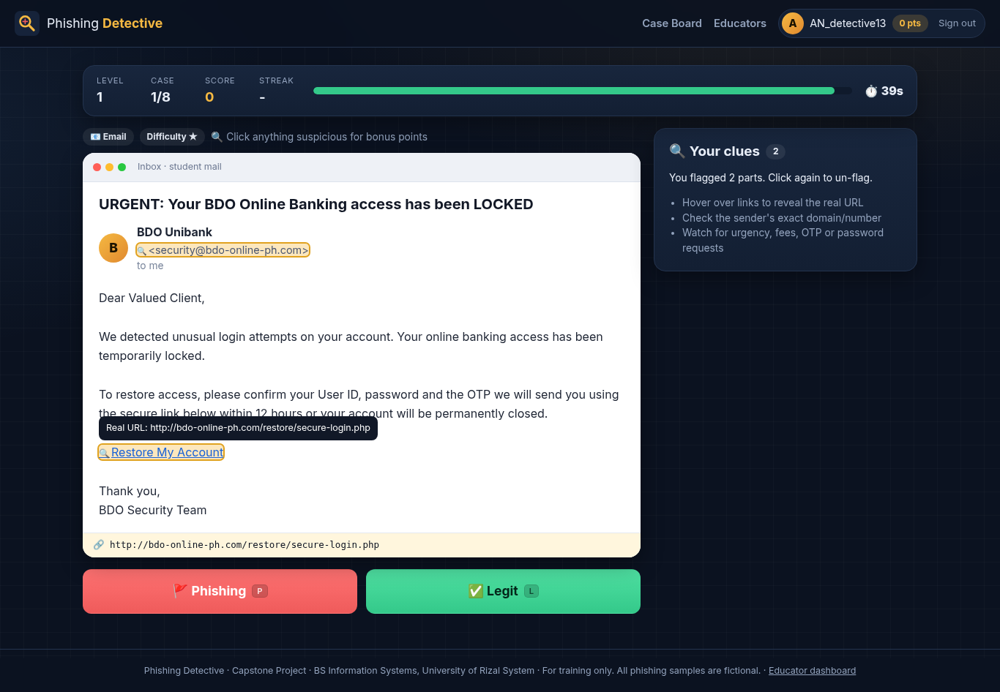

# 🕵️ Phishing Detective
### Interactive Web Game for Cybersecurity Awareness

A browser-based game where university students identify phishing emails, SMS and social-media DMs through timed challenges. Players learn real-world detection skills with instant feedback, and educators measure the impact with pre- and post-game quizzes.

> Capstone Project · BS Information Systems · University of Rizal System (Philippines)

| | |
|---|---|
| **Problem** | Students lack practical experience recognizing phishing attempts, leading to high susceptibility to security breaches. |
| **Target users** | University students (Filipino context: GCash, BDO/BPI, scholarships, enrollment/portal, Shopee/Lazada, LBC, job offers) |
| **Stack** | React 18 + Vite (HTML5/JS) · Node.js + Express · Supabase Postgres in production, SQLite for zero-setup local dev |
| **Live demo** | https://phishing-detective-mu.vercel.app (Vercel + Supabase) |
| **Expected impact** | ≥ 20% improvement in detection rate, measured by pre- vs post-game quizzes (computed live on the admin dashboard) |



---

## 1. Quick start

Requirements: **Node.js 18+** (tested on Node 24) and npm.

```bash
npm install          # installs root, client and server (npm workspaces)
cp server/.env.example server/.env   # optional; defaults work without it

# Development (hot reload): API on :3000 + Vite on :5173 (proxying /api)
npm run dev          # open http://localhost:5173

# Production: build the React app and serve it from Express
npm run build
npm start            # open http://localhost:3000
```

The SQLite database (`server/data/phishing-detective.db`) is created and seeded with **42 scenarios** automatically on first start. No database setup is needed.

### Default admin password
```
detective2026
```
Change it in `server/.env` → `ADMIN_PASSWORD=...` (and set a random `ADMIN_SECRET`) before running a real study. Educators open **/admin** (or the footer link "Educator dashboard").

### Useful scripts
| Command | What it does |
|---|---|
| `npm run dev` | Runs the server (`node --watch`) and the Vite client together |
| `npm run build` | Builds the React client to `client/dist` |
| `npm start` | Starts Express on `PORT` (default 3000) and serves `client/dist` |
| `npm test` | API integration tests (`node:test`, in-memory SQLite; set `DATABASE_URL` to run them against Postgres) |
| `npm run test:api` | curl smoke test of the full flow against a running server (`scripts/api-smoke.sh`) |
| `npm run demo` | Simulates 12 `demo_student##` players through the real API so the dashboard has sample data |
| `npm run seed` | **Resets** the database (deletes all players/results) and re-seeds the scenario bank |
| `python3 scripts/screenshots.py` | Headless Playwright check + screenshots into `screenshots/` |

> ⚠️ Before collecting real study data, run `npm run seed` to wipe test and demo players.

---

## 1b. Deploying to Vercel + Supabase

Production runs on **Vercel**: the static Vite build is served from the CDN and Express runs as one serverless function. Data lives in **Supabase Postgres**, because SQLite files don't persist on serverless.

- `api/index.js` is the serverless entry. It wraps the same Express app (`createApp()` in `server/src/index.js`).
- `vercel.json` builds with `npm run build`, serves `client/dist`, rewrites `/api/*` to the function and everything else to `index.html` (SPA fallback). The function region is `sin1` (Singapore, next to the Supabase project).
- Storage is picked automatically: `DATABASE_URL` set → Postgres (`server/src/db/postgres.js`), otherwise SQLite. See [`docs/supabase-migration.md`](docs/supabase-migration.md).

Vercel environment variables (Project → Settings → Environment Variables):

| Name | Value |
|---|---|
| `DATABASE_URL` | Supabase **pooler** URL (port 6543) for the `pd_app` role |
| `ADMIN_PASSWORD` | educator dashboard password |
| `ADMIN_SECRET` | long random string used to sign admin tokens |

Deploy from the CLI:
```bash
npm i -g vercel
vercel link            # pick/create the project
vercel deploy --prod
```
Or import the GitHub repo in the Vercel dashboard. The settings in `vercel.json` are picked up automatically.

---

## 2. How the game works

1. **Register** with a nickname or student ID only (3-24 letters/numbers, `_ . -`). No names, emails or passwords are collected. Entering the same ID again resumes progress.
2. **Pre-game quiz**: 10 messages, Phishing or Legit, no timer and no feedback (so it doesn't teach the answers).
3. **Timed rounds**: 8 randomized messages per round (40s / 35s / 30s per message for difficulty 1 / 2 / 3).
   - Click anything suspicious (sender, subject, any sentence, links, attachments) to mark it as a **clue**.
   - Hover over (or tap) a link to see its **real URL** in a tooltip and the browser-style status bar.
   - Decide **🚩 Phishing** or **✅ Legit** (keyboard: `P` / `L`, `Enter` for next).
4. **Instant feedback**: verdict, points breakdown, every red flag numbered and highlighted in the message (green = you caught it, red = missed), "why it's safe" for legit messages, and an explanation.
5. **Round summary**: score, accuracy, best streak, average time, clues found, and a case log.
6. **Progressive difficulty**: Level 2 unlocks at ≥ 70% accuracy in a Level 1 round; Level 3 at ≥ 70% in Level 2.
7. **Post-game quiz**: unlocked after at least one finished round. 10 *different* messages, then a full answer review and the player's personal improvement.

### Scoring
| Component | Rule |
|---|---|
| Base | 100 × difficulty (correct answers only) |
| Time bonus | up to +50, proportional to time left |
| Streak multiplier | ×1.0, ×1.1, … up to ×1.5 for consecutive correct answers |
| Clue bonus | +20 per correctly clicked red flag, −10 per wrong click |
| Timeout | counts as incorrect, resets streak |

Ranks: Rookie → Detective (1,000) → Senior Inspector (3,000) → Chief Detective (6,000). A top-10 leaderboard is shown on the case board.

---

## 3. Mapping to the capstone objectives

| Objective / feature in the proposal | Where it is implemented |
|---|---|
| Browser-based game, HTML5 + JavaScript (React) | `client/` (React 18 + Vite SPA, mobile-friendly CSS) |
| Node.js backend serving randomized scenarios | `server/src/routes/game.js` and `lib/game.js` → `pickScenarios()` (weighted by level, guarantees a phishing/legit mix) |
| **Randomized phishing scenarios** | 42 seed scenarios in `server/src/data/scenarios.js`: 24 phishing / 18 legit, 14 per difficulty level, across email, SMS and social DMs (Messenger, Instagram, Telegram, Facebook), each with red flags + explanation |
| Timed challenges | Per-message countdown in `client/src/pages/Game.jsx` and `components/Timer.jsx`; time limits in `lib/game.js` |
| **Score and feedback system** | Server-side `scoreAnswer()` (base, time bonus, streak, clue bonus); feedback panel and round summary in `Game.jsx` |
| **Progressive difficulty levels** | `unlockedLevels()` in `lib/game.js` (70% accuracy rule); locked level cards in `Hub.jsx` |
| **Admin dashboard for educators** | `client/src/pages/Admin.jsx` + `server/src/routes/admin.js`: players, sessions, pre/post averages, improvement %, per-scenario miss rates, accuracy by level/channel, CSV exports, scenario CRUD with validation and live preview |
| Simple gamification | Points, streaks 🔥, ranks, level unlocks, leaderboard |
| Analytics | Every answer is logged (choice, correctness, time, clues found). `repo.overview()` and `repo.scenarioStats()` aggregate the data |
| **Expected impact (≥ 20% improvement)** | Pre and post pools in `server/src/data/quiz.js` (10 items each, matched: 6 phishing + 4 legit, difficulty 1-3). The dashboard shows paired first-pre vs first-post averages, the **relative improvement %**, percentage-point change, how many players improved ≥ 20%, and a "Target met" badge |
| Privacy | Nickname or student ID only. No PII fields exist in the schema |

### Suggested evaluation protocol (for Chapter 3/4)
1. Run `npm run seed` to start clean, then deploy or run on a laptop on the campus LAN.
2. Participants register with an assigned code (e.g. `IS4A-01`) for anonymity.
3. Pre-quiz → at least 2-3 rounds (ideally reaching Level 2) → post-quiz.
4. Export `quiz.csv` / `players.csv` from the dashboard. Relative improvement = (post − pre) / pre × 100. A paired t-test or Wilcoxon signed-rank test on `pre_score` vs `post_score` in `players.csv` gives statistical significance.
5. Use **Miss rates** to see which scam types students struggle with most.

Measurement notes: only each player's **first** pre and **first** post attempt are used in the impact numbers (retakes can't inflate results). The pre-quiz can be taken only once and reveals no answers.

---

## 4. Architecture

```
phishing-detective/
├── package.json              # npm workspaces + dev/build/start scripts
├── api/index.js              # Vercel serverless entry (wraps the Express app)
├── vercel.json               # Vercel build, static output, /api rewrites, SPA fallback
├── client/                   # React + Vite front end
│   ├── index.html
│   └── src/
│       ├── App.jsx, main.jsx, styles.css
│       ├── lib/api.js        # fetch wrapper for every endpoint
│       ├── lib/player.jsx    # player context (localStorage)
│       ├── components/       # Header, MessageView (email/SMS/DM renderer), Timer
│       └── pages/            # Home, Hub (case board), Quiz, Game, Admin
├── server/
│   ├── .env.example
│   ├── src/
│   │   ├── index.js          # Express app; serves client/dist in production
│   │   ├── routes/           # players.js, game.js, quiz.js, admin.js
│   │   ├── lib/              # game.js (rules), auth.js (admin token), csv.js
│   │   ├── db/               # index.js (repo factory), postgres.js, sqlite.js, schema.sql, seed.js
│   │   └── data/             # scenarios.js (42 items), quiz.js (pre/post pools)
│   ├── data/                 # SQLite file (auto-created)
│   └── test/api.test.js
├── docs/                     # architecture + ERD (mermaid), Postgres schema, Supabase guide
├── scripts/                  # api-smoke.sh, demo-data.mjs, screenshots.py
└── screenshots/
```

- System architecture and sequence diagrams: [`docs/architecture.md`](docs/architecture.md)
- ERD: [`docs/erd.md`](docs/erd.md)
- Swap to Supabase/Postgres: [`docs/supabase-migration.md`](docs/supabase-migration.md) and [`docs/schema.postgres.sql`](docs/schema.postgres.sql)

Security notes: answers and red flags are never sent to the browser before the player answers, and scoring happens on the server. Admin routes need an HMAC-signed bearer token (8-hour expiry). Links inside messages never navigate (`preventDefault`), and all phishing domains are fictional.

---

## 5. API reference

Base URL: `/api`. JSON in and out.

### Player & game
| Method | Endpoint | Body / query | Description |
|---|---|---|---|
| GET | `/health` | | Status + scenario count |
| POST | `/players` | `{ nickname }` | Register or resume (201 new / 200 existing) |
| GET | `/players/:id/progress` | | Unlocked level, totals, rank, quiz results, per-level bests |
| GET | `/leaderboard` | | Top 10 by total score |
| GET | `/scenarios/random` | `?level=1-3&count=n` | Random sanitized scenarios (preview/demo) |
| POST | `/sessions` | `{ playerId, level }` | Start a round: 8 sanitized scenarios with clickable segments (403 if locked) |
| POST | `/sessions/:id/answers` | `{ scenarioId, choice: "phishing"\|"legit"\|null, timeMs, clickedParts: ["sender","subject","seg:3","link:0","att:0"] }` | Score one answer; returns correctness, points breakdown, red flags (found/missed), safe signs, explanation |
| POST | `/sessions/:id/finish` | | Round summary + `newlyUnlocked` level |

### Quizzes
| Method | Endpoint | Body | Description |
|---|---|---|---|
| GET | `/quiz/pre` · `/quiz/post` | | 10 shuffled items (no answers) |
| POST | `/quiz/:kind/submit` | `{ playerId, answers: [{ itemId, choice }] }` | Grades and stores the attempt. Pre: once only, score only. Post: needs pre + 1 finished round; returns review + improvement |

### Admin (header `Authorization: Bearer <token>`)
| Method | Endpoint | Description |
|---|---|---|
| POST | `/admin/login` | `{ password }` → `{ token }` |
| GET | `/admin/stats` | Totals, accuracy, pre/post averages, paired improvement %, target met, by level/channel |
| GET | `/admin/players` | Players with rounds, score, accuracy, pre/post |
| GET | `/admin/sessions` | All sessions |
| GET | `/admin/scenario-stats` | Attempts, misses, miss rate, avg time per scenario |
| GET | `/admin/export/:kind.csv` | `players`, `sessions`, `answers`, `quiz`, `scenarios` (also accepts `?token=`) |
| GET / POST | `/admin/scenarios` | List / create (validated: red-flag snippets must exist in the body) |
| GET / PUT / DELETE | `/admin/scenarios/:id` | Read / update / delete |

Example:
```bash
curl -X POST localhost:3000/api/players -H 'Content-Type: application/json' -d '{"nickname":"sherlock_01"}'
curl -X POST localhost:3000/api/sessions -H 'Content-Type: application/json' -d '{"playerId":1,"level":1}'
TOKEN=$(curl -s -X POST localhost:3000/api/admin/login -H 'Content-Type: application/json' -d '{"password":"detective2026"}' | node -pe 'JSON.parse(require("fs").readFileSync(0)).token')
curl localhost:3000/api/admin/stats -H "Authorization: Bearer $TOKEN"
```

### Scenario format (for the admin editor / `data/scenarios.js`)
```js
{
  id: 'bdo-sms-link', channel: 'sms', difficulty: 2, isPhishing: true,
  senderName: 'BDO', senderAddress: 'BDO', subject: undefined, platform: undefined,
  body: 'BDO: A new device was enrolled... cancel the enrollment immediately at {{link:0}}',
  links: [{ text: 'bdo.com.ph-secure.help', href: 'https://bdo.com.ph-secure.help/cancel' }],
  attachments: [],
  redFlags: [
    { target: 'link', index: 0, label: 'Domain trick', detail: '...' },
    { target: 'body', match: 'cancel the enrollment immediately', label: 'Urgency', detail: '...' },
    { target: 'sender', label: 'Spoofed sender ID', detail: '...' },
  ],
  safeSigns: [],            // for legit messages
  explanation: '...',
}
```

---

## 6. Screenshots
| | |
|---|---|
| Home | `screenshots/01-home.png` |
| Pre-quiz | `screenshots/02-pre-quiz-intro.png`, `03-pre-quiz-item.png` |
| Case board (levels, leaderboard) | `screenshots/04-case-board.png` |
| Game round (clues + link hover) | `screenshots/05-game-round.png` |
| Feedback | `screenshots/06-feedback.png` |
| Round summary | `screenshots/07-round-summary.png` |
| Admin dashboard | `screenshots/08-admin-dashboard.png`, `09-admin-miss-rates.png`, `10-admin-scenario-editor.png` |
| Mobile | `screenshots/11-mobile-home.png`, `12-mobile-game.png` |

The admin screenshots use simulated `demo_student##` data from `npm run demo`. They are **not** real study results.

---

## 7. Limitations & future work
- Player identity is the nickname only (no password), so anyone who knows an ID can continue that player's progress. That's acceptable for anonymous classroom use. Add a PIN or university SSO for high-stakes use.
- Admin auth is a single shared password (no user accounts or roles).
- `timeMs` is reported by the client (clamped server-side). A determined player could fake fast times for a higher time bonus. This doesn't affect quiz-based impact measurement.
- Quiz items live in code so the study instrument stays fixed. Editing them requires a code change (by design).
- SQLite is for local development only. Production uses Supabase Postgres (free tier: the project pauses after about a week of inactivity and must be resumed from the Supabase dashboard).
- Timestamps are stored in UTC (SQLite `datetime('now')`).
- Ideas: badges/achievements, per-section class codes, spaced-repetition of missed scam types, Tagalog/English toggle, an image-based QR "quishing" renderer, and question-level item analysis for the quizzes.
