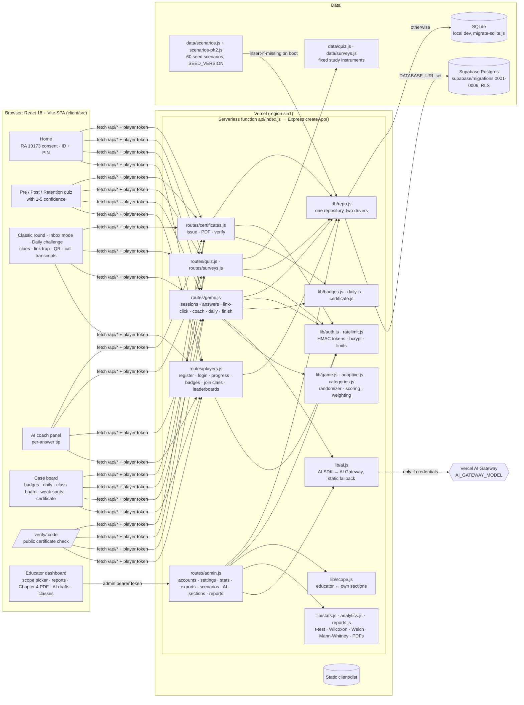
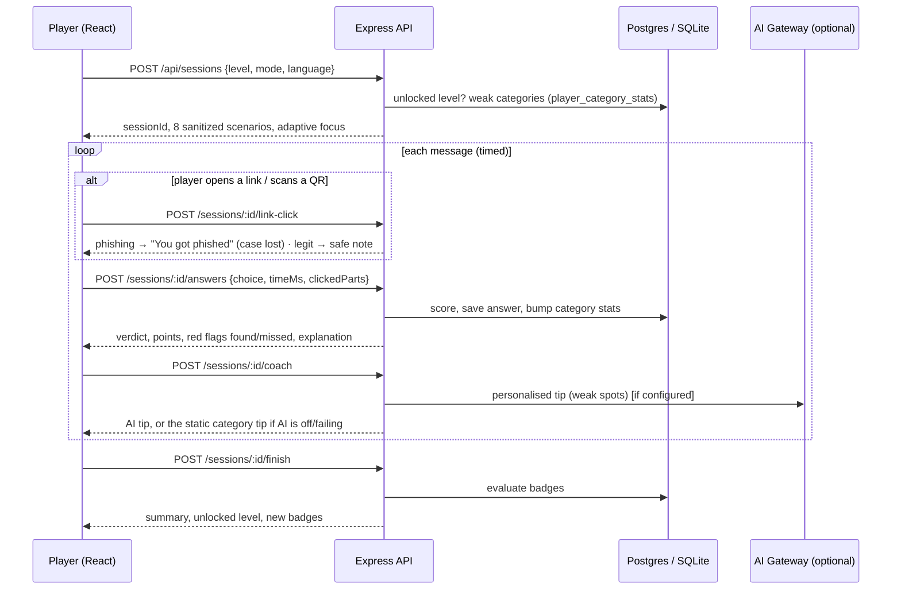

# System Architecture

## One classic round

## Design notes
- **Server-authoritative scoring.** Scenarios are sanitized (`publicScenario`) before they reach the browser; answers, red flags and scores are computed on the server.
- **Clickable clues.** The server splits each body into segments and isolates every red-flag snippet, so the client only returns part keys (`sender`, `seg:3`, `link:0`, `att:0`).
- **Adaptive selection.** Every answer updates `player_category_stats` (seen/missed per red-flag category). With at least 4 answers of evidence, rounds use an Efraimidis-Spirakis weighted shuffle that favours scenarios touching the player's weakest categories (weakness = (missed+1)/(seen+2)), while keeping the phishing/legit mix.
- **AI is optional and reviewed.** `lib/ai.js` uses the AI SDK (`generateText` + `Output.object` with a zod schema) through the Vercel AI Gateway. Generated scenarios are saved as `status='pending'`, `active=false` and are never served until an educator approves them (approval re-runs the same validator as manual scenarios). The coach falls back to static, category-specific tips; after a gateway failure it pauses AI calls for 5 minutes so players never wait on a broken provider.
- **Educator scoping.** `lib/scope.js` resolves which students an admin may see: superadmins see everyone (optionally one section); educators see only students in sections they own. Every list, stat, export, report and Chapter 4 PDF goes through `scopedData()`.
- **Research statistics in one place.** `lib/stats.js` implements paired t, Welch, Wilcoxon signed-rank and Mann-Whitney U (verified against reference values in tests). `lib/analytics.js` turns raw attempts into group comparisons, and `lib/reports.js` renders the Chapter 4 PDF with pdfkit.
- **Certificates.** Issued after the post-quiz, with an unguessable code `PD-XXXX-XXXX-XXXX` (crypto random, no ambiguous characters). `/api/verify/:code` and the `/verify/:code` page confirm it publicly; the PDF embeds a QR code to the verify page.
- **Additive migrations only.** `supabase/migrations/0001…0006` never drop data; `server/src/db/migrate-sqlite.js` mirrors each one for SQLite. `npm run test:pg` runs the whole suite against Postgres (PGlite) after applying every migration.
