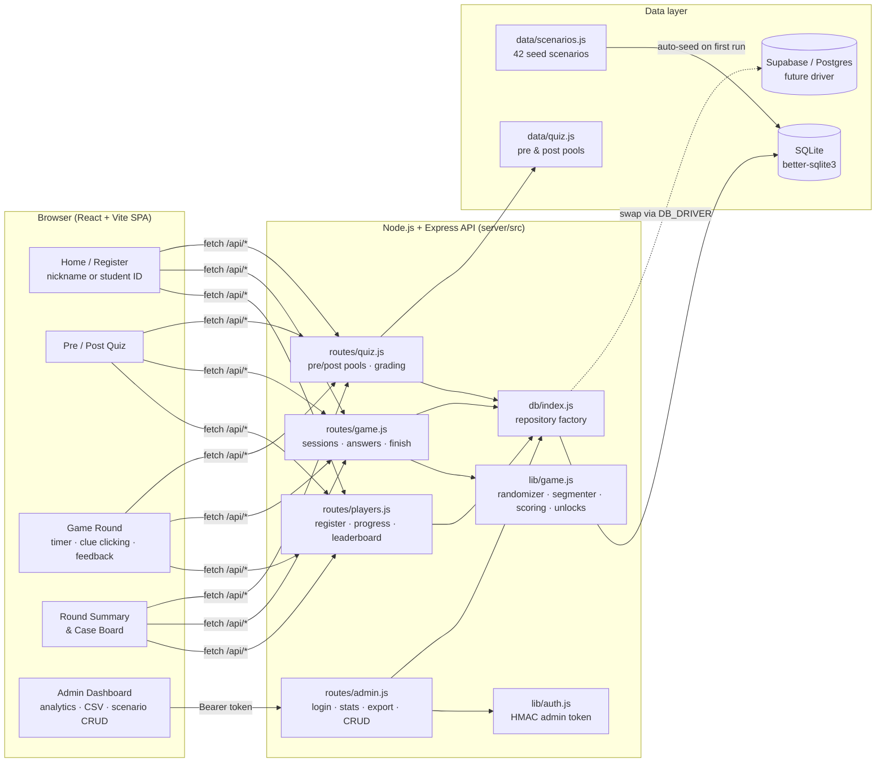
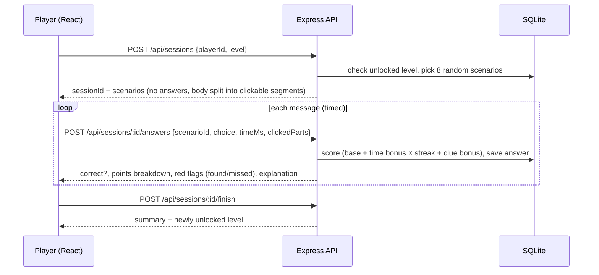

# System Architecture

## Request flow for one game round

Design notes
- **Answers never reach the client before the player commits.** Scenarios are sanitized (`publicScenario`) and scored server-side, so the game cannot be cheated from DevTools.
- **Clickable clues:** the server splits each message body into sentence segments and isolates each red-flag snippet as its own segment. The client returns the part keys the player clicked (`sender`, `subject`, `seg:3`, `link:0`, `att:0`) and the server matches them against the red flags.
- **Swappable data layer:** routes only call async repository methods (`findOrCreatePlayer`, `createSession`, `recordAnswer`, `overview`, …). A Postgres/Supabase repository with the same method names can replace `db/sqlite.js`; see `supabase-migration.md`.
