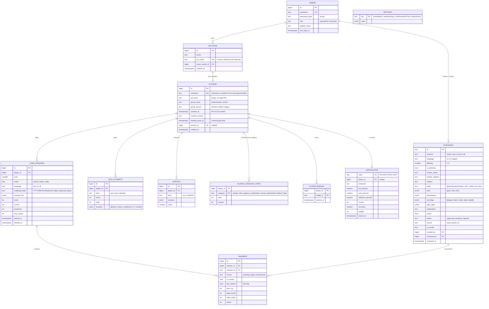

# Entity Relationship Diagram

Notes
- Quiz items, survey items and badge definitions are versioned in code (`server/src/data/quiz.js`, `data/surveys.js`, `lib/badges.js`) so the study instruments stay fixed; only responses are stored.
- Deleting a player cascades to sessions, answers, quiz attempts, surveys, category stats, badges and the certificate (data-subject erasure). Deleting a section only clears `players.section_id`. Deleting an admin sets `owner_admin_id`, `created_by` and `reviewed_by` to null.
- All tables have RLS enabled with access revoked from Supabase's public `anon`/`authenticated` roles; only the server's `pd_app` role can read and write.
